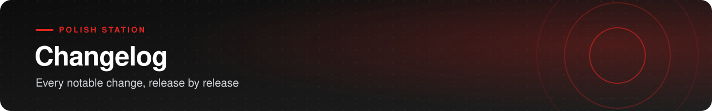

 

<strong>Every notable change to this project, newest first.</strong>

---

> [!NOTE]
> The format follows [Keep a Changelog](https://keepachangelog.com/en/1.1.0/) and the project uses [Semantic Versioning](https://semver.org/spec/v2.0.0.html). Each version links to its full comparison at the bottom of this page, and to its [release notes](https://github.com/saadmaz/Polish-Station-Website/releases).

## [Unreleased]

### Removed

- Sanity and the blog. `/blog` now redirects to the home page until posts return through the Polish Station admin portal; drafts are kept in `content/blog-drafts/`.

### Fixed

- The contact form asks visitors to call or WhatsApp when online messages aren't configured, instead of failing on submit.

- The Google reviews fetch now uses Places API (New). The legacy Places API it called can no longer be enabled on new Google Cloud projects.

## [1.2.0] - 2026-11-17

### Changed

- Hosting moves from cPanel shared hosting to an assets-only Cloudflare Worker deployed with Wrangler. Security headers, asset caching and redirects now live in `public/_headers`, `public/_redirects` and `wrangler.jsonc`. Production deploys switch on with the `CLOUDFLARE_ENABLED` variable.

### Removed

- An unused hook and 20 unused dependencies. Installs and the repository are smaller; the site is unchanged.
- cPanel deployment: `.cpanel.yml`, the Apache `.htaccess` and the SSH deploy-branch pipeline.

## [1.1.3] - 2026-11-17

### Changed

- Contributing, Security Policy, Code of Conduct, License and Changelog redesigned with branded headers, navigation, tables, diagrams and callouts; the licence is now LICENSE.md.

## [1.1.2] - 2026-11-17

### Changed

- README shows the development environment as awaiting host setup until development deploys are enabled.

## [1.1.1] - 2026-11-17

### Changed

- Redesigned README with a brand banner, live release, CI and deployment badges, action buttons, feature grid, diagrams and collapsible panels.
- Navigation bars and callouts across the contributing, security, conduct and documentation pages.

## [1.1.0] - 2026-11-17

### Added

- Development and production environments: `develop` deploys to development and `main` to production, through one Deploy workflow and GitHub Environments with per-environment settings.

## [1.0.0] - 2026-11-16

First versioned release of [polishstation.lk](https://www.polishstation.lk), covering everything shipped to production since launch.

### Added

- Home page with hero, services, packages, process, before-and-after comparison, gallery, Google reviews, FAQ teaser and call to action.
- Dedicated routes for About, Services (with a detail page per service), Gallery, Blog, FAQ, Contact and Book.
- Multi-service booking form with a date picker and an "other service" option, submitted to the POS intake API.
- Contact form that writes enquiries to the POS Firestore project, and newsletter sign-ups stored as POS subscribers.
- Blog powered by Sanity Studio, with automatic rebuild and deploy on publish.
- Google reviews fetched at build time.
- Full static prerender of every route for shared hosting.
- SEO: per-page metadata, Open Graph images, `Offer`, `BreadcrumbList`, `FAQPage` and `ImageObject` structured data, generated sitemap, `robots.txt` and `llms.txt`.
- Google Tag Manager and Search Console verification.
- Sticky mobile Call / WhatsApp / Book bar and a floating WhatsApp button.
- Automated deployment to cPanel through a `deploy` branch and SSH.
- Continuous integration on every push and pull request: lint, formatting, type check and production build.
- Project governance: proprietary licence, security policy, contribution guidelines, code of conduct, issue forms, pull request template, CODEOWNERS and Dependabot.
- Standard documentation layout shared by every STTPS repository: architecture, configuration, deployment, decision records (ADRs) and release and rollback runbooks, indexed in `docs/README.md`.

### Changed

- Bun is the single package manager; the duplicate npm lockfile was removed and the Bun version is pinned in CI.
- Source files formatted to the project Prettier configuration.

### Fixed

- Type error from a deep import of the Sanity image URL types.
- A malformed blog slug no longer fails the whole build.

### Removed

- Unused scaffold server function and configuration module.

[Unreleased]: https://github.com/saadmaz/Polish-Station-Website/compare/v1.2.0...HEAD
[1.2.0]: https://github.com/saadmaz/Polish-Station-Website/compare/v1.1.3...v1.2.0
[1.1.3]: https://github.com/saadmaz/Polish-Station-Website/compare/v1.1.2...v1.1.3
[1.1.2]: https://github.com/saadmaz/Polish-Station-Website/compare/v1.1.1...v1.1.2
[1.1.1]: https://github.com/saadmaz/Polish-Station-Website/compare/v1.1.0...v1.1.1
[1.1.0]: https://github.com/saadmaz/Polish-Station-Website/compare/v1.0.0...v1.1.0
[1.0.0]: https://github.com/saadmaz/Polish-Station-Website/releases/tag/v1.0.0
