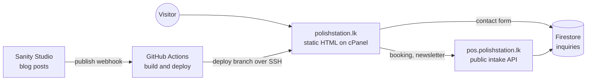

<div align="center">

# Polish Station

**Restore. Protect. Perfect.**

The official website of Polish Station, a premium automotive detailing studio in Dehiwala, Sri Lanka.

[](https://www.polishstation.lk)
[](https://github.com/saadmaz/Polish-Station-Website/actions/workflows/deploy.yml)
[](https://github.com/saadmaz/Polish-Station-Website/actions/workflows/ci.yml)


[**polishstation.lk**](https://www.polishstation.lk) · [Report a bug](https://github.com/saadmaz/Polish-Station-Website/issues/new?template=bug_report.yml) · [Request a change](https://github.com/saadmaz/Polish-Station-Website/issues/new?template=feature_request.yml)

</div>

---

## Contents

- [About](#about)
- [Features](#features)
- [Architecture](#architecture)
- [Tech stack](#tech-stack)
- [Getting started](#getting-started)
- [Configuration](#configuration)
- [Project structure](#project-structure)
- [Content management](#content-management)
- [Quality checks](#quality-checks)
- [Deployment](#deployment)
- [Releases and versioning](#releases-and-versioning)
- [Contributing](#contributing)
- [Security](#security)
- [License](#license)

## About

Polish Station restores, protects and perfects vehicle finishes using paint-depth analysis, certified technicians, premium products and multi-light inspection. This repository powers [polishstation.lk](https://www.polishstation.lk): the services, gallery, reviews and booking flow customers use to book a detail.

|                  |                                                                         |
| ---------------- | ----------------------------------------------------------------------- |
| **Organisation** | Polish Station (Pvt) Ltd                                                |
| **Website**      | [polishstation.lk](https://www.polishstation.lk)                        |
| **Studio**       | 22C, Saranankara Road, Dehiwala · Mon to Sat, 8:00 to 19:00             |
| **Contact**      | [info@polishstation.lk](mailto:info@polishstation.lk) · +94 71 188 5252 |
| **Maintainer**   | [Saad Mazhar](https://github.com/saadmaz)                               |

## Features

- **Service pages:** Paint correction, cut and polish, ceramic and graphene coating, interior and exterior detailing, engine bay cleaning and headlight restoration, each with its own detail page.
- **Online booking:** A multi-service booking form with a date picker, sent straight into the Polish Station POS.
- **Contact and newsletter:** Enquiries land in the POS Inquiries screen; newsletter sign-ups are stored as POS subscribers.
- **Blog:** Articles written and published in Sanity Studio, rebuilt and deployed automatically on publish.
- **Social proof:** Google reviews fetched at build time, before-and-after comparisons and a gallery.
- **Fully static:** Every route is prerendered to HTML, so the site is fast and runs on plain shared hosting.
- **SEO:** Per-page metadata and Open Graph images, a generated `sitemap.xml`, `robots.txt` and `llms.txt`.
- **Mobile-first contact:** Sticky Call / WhatsApp / Book bar on phones and a floating WhatsApp button.

## Architecture



The website holds no customer data of its own. Every submission is handed to the [Polish Station POS](https://github.com/saadmaz/Polish-Station-POS), where staff manage bookings, leads and subscribers.

## Tech stack

| Layer     | Technology                                                                                         |
| --------- | -------------------------------------------------------------------------------------------------- |
| Framework | [TanStack Start](https://tanstack.com/start) (React 19, file-based routing, full static prerender) |
| Language  | TypeScript (strict)                                                                                |
| Styling   | Tailwind CSS v4 and Radix-based UI primitives                                                      |
| Forms     | React Hook Form + Zod                                                                              |
| Content   | Sanity (blog), Google Places API (reviews, build time only)                                        |
| Data      | Firebase Firestore and the POS intake API                                                          |
| Build     | Vite                                                                                               |
| Hosting   | cPanel shared hosting, deployed by GitHub Actions                                                  |
| Tooling   | Bun, ESLint, Prettier                                                                              |

## Getting started

### Prerequisites

- [Bun](https://bun.sh) 1.4 or later
- Git

### Install and run

```sh
git clone https://github.com/saadmaz/Polish-Station-Website.git
cd Polish-Station-Website
bun install
cp .env.example .env    # fill in the values you need
bun run dev
```

Vite prints the local address when the server starts.

### Scripts

| Command                    | Description                                                         |
| -------------------------- | ------------------------------------------------------------------- |
| `bun run dev`              | Start the development server with hot reload                        |
| `bun run build`            | Regenerate the sitemap, then prerender the site into `dist/client/` |
| `bun run preview`          | Serve the production build locally                                  |
| `bun run lint`             | Lint with ESLint (includes Prettier rules)                          |
| `bun run typecheck`        | Type-check the project with `tsc`                                   |
| `bun run format`           | Format with Prettier                                                |
| `bun run format:check`     | Check formatting without writing                                    |
| `bun run fetch:reviews`    | Refresh `src/lib/data/reviews.generated.json` from Google           |
| `bun run generate:sitemap` | Regenerate `public/sitemap.xml`                                     |

## Configuration

Copy [`.env.example`](.env.example) to `.env`. Every `VITE_*` value is compiled into the browser bundle and is a public identifier, not a secret.

| Variable                                        | Purpose                                                                 |
| ----------------------------------------------- | ----------------------------------------------------------------------- |
| `VITE_POS_API_BASE_URL`                         | Base URL of the POS public intake API (`https://pos.polishstation.lk`)  |
| `VITE_SANITY_PROJECT_ID`, `VITE_SANITY_DATASET` | Sanity project for the blog. Unset renders an empty blog                |
| `VITE_FIREBASE_*`                               | Firebase web app config for the POS Firestore project (contact form)    |
| `GOOGLE_PLACES_API_KEY`, `GOOGLE_PLACE_ID`      | Used only by `fetch:reviews` at build time; never shipped to the client |

In CI these come from GitHub Actions secrets (see [Deployment](#deployment)).

## Project structure

```
.
├── .github/workflows/       # CI on pull requests, deploy on main
├── .cpanel.yml              # Server-side copy into public_html
├── content/blog-drafts/     # Article drafts in Markdown before they go into Sanity
├── public/                  # robots.txt, sitemap.xml, llms.txt, logo
├── scripts/                 # Sitemap generator and Google reviews fetcher
├── src/
│   ├── assets/              # Photography, fonts and Open Graph images
│   ├── components/
│   │   ├── site/            # Page sections: Hero, Services, Packages, Reviews...
│   │   └── ui/              # Radix-based UI primitives
│   ├── hooks/               # Scroll reveal, count-up and tilt effects
│   ├── lib/
│   │   ├── api/             # POS intake API and Firestore inquiries
│   │   ├── data/            # Services, pricing, FAQ, gallery, reviews, blog client
│   │   └── seo.ts           # Page metadata helpers
│   ├── routes/              # File-based routes (see src/routes/README.md)
│   └── styles.css           # Design tokens and global styles
└── studio/                  # Sanity Studio for writing blog posts
```

## Content management

| Task                                   | Where                                                                                                                                         |
| -------------------------------------- | --------------------------------------------------------------------------------------------------------------------------------------------- |
| Edit services and service detail pages | `src/lib/data/services.ts`                                                                                                                    |
| Edit packages and pricing              | `src/lib/data/pricing.ts`                                                                                                                     |
| Edit FAQ                               | `src/lib/data/faq.ts`                                                                                                                         |
| Add gallery images                     | `src/assets/` and `src/lib/data/gallery-images.ts`                                                                                            |
| Refresh Google reviews                 | `bun run fetch:reviews`, then commit `reviews.generated.json`                                                                                 |
| Write and publish a blog post          | [Sanity Studio](https://polishstation.sanity.studio). Publishing triggers a rebuild automatically; see [`studio/README.md`](studio/README.md) |
| Add a page                             | Create a route in `src/routes/_layout/`, set its metadata with `src/lib/seo.ts` and add it to `scripts/generate-sitemap.ts`                   |

## Quality checks

Pull requests into `main` run the [CI workflow](.github/workflows/ci.yml): lint, formatting, type check and a full production build. Run the same checks locally before opening a pull request:

```sh
bun run lint && bun run format:check && bun run typecheck && bun run build
```

## Deployment

The site is static HTML served from cPanel shared hosting. [`deploy.yml`](.github/workflows/deploy.yml) publishes it on every push to `main`, on manual dispatch, and whenever a post is published in Sanity (`repository_dispatch: sanity-publish`).

1. GitHub Actions installs dependencies and runs `bun run build` with production values from repository secrets.
2. The prerendered output in `dist/client/` is force-pushed to the `deploy` branch together with [`.cpanel.yml`](.cpanel.yml).
3. The workflow connects over SSH, checks out `deploy` on the server and runs the cPanel deployment, which copies the files into `public_html`.

The `deploy` branch is a build artefact. Never commit to it by hand.

### Required secrets

| Secret                                                                                                                                          | Purpose                                  |
| ----------------------------------------------------------------------------------------------------------------------------------------------- | ---------------------------------------- |
| `SANITY_PROJECT_ID`, `SANITY_DATASET`                                                                                                           | Blog content at build time               |
| `FIREBASE_API_KEY`, `FIREBASE_AUTH_DOMAIN`, `FIREBASE_PROJECT_ID`, `FIREBASE_STORAGE_BUCKET`, `FIREBASE_MESSAGING_SENDER_ID`, `FIREBASE_APP_ID` | Firebase web config for the contact form |
| `ZIRCON_SSH_HOST`, `ZIRCON_SSH_PORT`, `ZIRCON_SSH_USER`, `ZIRCON_SSH_KEY`                                                                       | SSH access to the hosting account        |

## Releases and versioning

The project follows [Semantic Versioning](https://semver.org). Each release is tagged `vX.Y.Z` and published on the [Releases](https://github.com/saadmaz/Polish-Station-Website/releases) page. Notable changes are recorded in [CHANGELOG.md](CHANGELOG.md).

## Contributing

Read [CONTRIBUTING.md](CONTRIBUTING.md) for the branching model, commit conventions and pull request checklist. All participants are expected to follow the [Code of Conduct](CODE_OF_CONDUCT.md).

## Security

Please do not report security issues in public issues. See [SECURITY.md](SECURITY.md) for how to report a vulnerability privately.

## License

Copyright © 2026 Polish Station (Pvt) Ltd. All rights reserved.

This is proprietary software. No permission is granted to use, copy, modify or distribute it without prior written consent. See [LICENSE](LICENSE).
