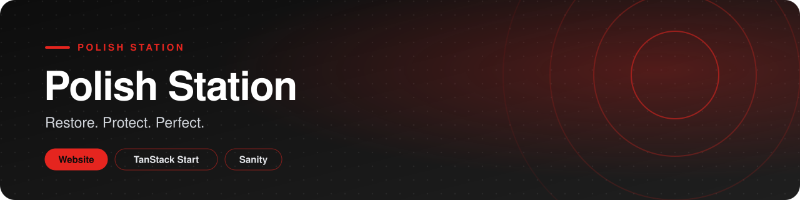
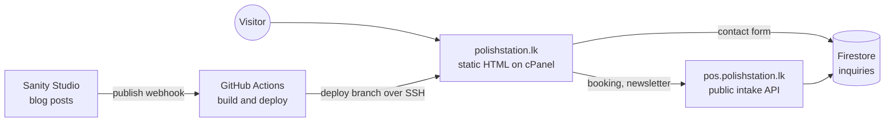
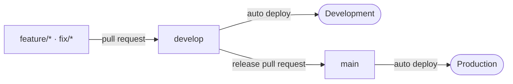

<a id="readme-top"></a>

<div align="center">



<br/>

<p><strong>The official website of Polish Station, a premium automotive detailing studio in Dehiwala, Sri Lanka.</strong></p>

<a href="https://github.com/saadmaz/Polish-Station-Website/releases"></a>
<a href="https://github.com/saadmaz/Polish-Station-Website/actions/workflows/ci.yml"></a>
<a href="https://github.com/saadmaz/Polish-Station-Website/deployments"></a>
<a href="https://github.com/saadmaz/Polish-Station-Website/commits/develop"></a>


<br/>

<a href="https://www.polishstation.lk"></a>
<a href="docs/README.md"></a>
<a href="https://github.com/saadmaz/Polish-Station-Website/issues/new?template=bug_report.yml"></a>
<a href="https://github.com/saadmaz/Polish-Station-Website/issues/new?template=feature_request.yml"></a>

<br/>

<a href="#about">About</a> ·
<a href="#features">Features</a> ·
<a href="#architecture">Architecture</a> ·
<a href="#getting-started">Getting started</a> ·
<a href="#deployment">Deployment</a> ·
<a href="#documentation">Documentation</a> ·
<a href="#contributing">Contributing</a>

</div>

---

<details>
<summary><strong>Table of contents</strong></summary>

1. [About](#about)
2. [Features](#features)
3. [Architecture](#architecture)
4. [Tech stack](#tech-stack)
5. [Getting started](#getting-started)
6. [Configuration](#configuration)
7. [Project structure](#project-structure)
8. [Quality checks](#quality-checks)
9. [Deployment](#deployment)
10. [Documentation](#documentation)
11. [Releases and versioning](#releases-and-versioning)
12. [Contributing](#contributing)
13. [Security](#security)
14. [License](#license)

</details>

## About

Polish Station restores, protects and perfects vehicle finishes using paint-depth analysis, certified technicians, premium products and multi-light inspection. This repository powers [polishstation.lk](https://www.polishstation.lk): the services, gallery, reviews and booking flow customers use to book a detail.

| At a glance      |                                                                         |
| ---------------- | ----------------------------------------------------------------------- |
| **Organisation** | Polish Station (Pvt) Ltd                                                |
| **Status**       | Live                                                                    |
| **Website**      | [polishstation.lk](https://www.polishstation.lk)                        |
| **Studio**       | 22C, Saranankara Road, Dehiwala · Mon to Sat, 8:00 to 19:00             |
| **Contact**      | [info@polishstation.lk](mailto:info@polishstation.lk) · +94 71 188 5252 |
| **Maintainer**   | [Saad Mazhar](https://github.com/saadmaz)                               |

<p align="right"><a href="#readme-top">Back to top ↑</a></p>

## Features

<table>
<tr><td width="50%" valign="top"><strong>Service pages</strong><br/>Paint correction, cut and polish, ceramic and graphene coating, interior and exterior detailing, engine bay cleaning and headlight restoration, each with its own detail page.</td><td width="50%" valign="top"><strong>Online booking</strong><br/>A multi-service booking form with a date picker, sent straight into the Polish Station POS.</td></tr>
<tr><td width="50%" valign="top"><strong>Contact and newsletter</strong><br/>Enquiries land in the POS Inquiries screen; newsletter sign-ups are stored as POS subscribers.</td><td width="50%" valign="top"><strong>Blog</strong><br/>Articles written and published in Sanity Studio, rebuilt and deployed automatically on publish.</td></tr>
<tr><td width="50%" valign="top"><strong>Social proof</strong><br/>Google reviews fetched at build time, before-and-after comparisons and a gallery.</td><td width="50%" valign="top"><strong>Fully static</strong><br/>Every route is prerendered to HTML, so the site is fast and runs on plain shared hosting.</td></tr>
<tr><td width="50%" valign="top"><strong>SEO</strong><br/>Per-page metadata and Open Graph images, a generated <code>sitemap.xml</code>, <code>robots.txt</code> and <code>llms.txt</code>.</td><td width="50%" valign="top"><strong>Mobile-first contact</strong><br/>Sticky Call / WhatsApp / Book bar on phones and a floating WhatsApp button.</td></tr>
</table>

<p align="right"><a href="#readme-top">Back to top ↑</a></p>

## Architecture

A TanStack Start site prerendered to static HTML and served from cPanel shared hosting. It stores no customer data: bookings and newsletter sign-ups go to the [Polish Station POS](https://github.com/saadmaz/Polish-Station-POS) intake API and contact enquiries to the POS Firestore project. Blog posts come from Sanity, and publishing triggers a rebuild.



> [!TIP]
> The full design, with every component and data flow, is in [docs/ARCHITECTURE.md](docs/ARCHITECTURE.md). Significant decisions are recorded as [architecture decision records](docs/adr/README.md).

<p align="right"><a href="#readme-top">Back to top ↑</a></p>

## Tech stack

<p>


</p>

<details>
<summary><strong>Full stack breakdown</strong></summary>

| Layer     | Technology                                                                                         |
| --------- | -------------------------------------------------------------------------------------------------- |
| Framework | [TanStack Start](https://tanstack.com/start) (React 19, file-based routing, full static prerender) |
| Language  | TypeScript (strict)                                                                                |
| Styling   | Tailwind CSS v4 and Radix-based UI primitives                                                      |
| Forms     | React Hook Form + Zod                                                                              |
| Content   | Sanity (blog), Google Places API (reviews, build time only)                                        |
| Data      | Firebase Firestore and the POS intake API                                                          |
| Build     | Vite                                                                                               |
| Hosting   | cPanel shared hosting, deployed by GitHub Actions                                                  |
| Tooling   | Bun, ESLint, Prettier                                                                              |

</details>

<p align="right"><a href="#readme-top">Back to top ↑</a></p>

## Getting started

### Prerequisites

- [Bun](https://bun.sh) 1.4 or later
- Git

### Install and run

```sh
git clone https://github.com/saadmaz/Polish-Station-Website.git
cd Polish-Station-Website
bun install
cp .env.example .env    # fill in the values you need
bun run dev
```

Vite prints the local address when the server starts.

<details>
<summary><strong>All scripts</strong></summary>

| Command                    | Description                                                         |
| -------------------------- | ------------------------------------------------------------------- |
| `bun run dev`              | Start the development server with hot reload                        |
| `bun run build`            | Regenerate the sitemap, then prerender the site into `dist/client/` |
| `bun run preview`          | Serve the production build locally                                  |
| `bun run lint`             | Lint with ESLint (includes Prettier rules)                          |
| `bun run typecheck`        | Type-check the project with `tsc`                                   |
| `bun run format`           | Format with Prettier                                                |
| `bun run format:check`     | Check formatting without writing                                    |
| `bun run fetch:reviews`    | Refresh `src/lib/data/reviews.generated.json` from Google           |
| `bun run generate:sitemap` | Regenerate `public/sitemap.xml`                                     |

</details>

<p align="right"><a href="#readme-top">Back to top ↑</a></p>

## Configuration

All `VITE_*` values are public identifiers compiled into the bundle: the POS API URL, the Sanity project and the Firebase web config. The Google Places key is used only at build time to refresh reviews.

<details>
<summary><strong>Environment variables</strong></summary>

| Variable                                        | Purpose                                                                 |
| ----------------------------------------------- | ----------------------------------------------------------------------- |
| `VITE_POS_API_BASE_URL`                         | Base URL of the POS public intake API (`https://pos.polishstation.lk`)  |
| `VITE_SANITY_PROJECT_ID`, `VITE_SANITY_DATASET` | Sanity project for the blog. Unset renders an empty blog                |
| `VITE_FIREBASE_*`                               | Firebase web app config for the POS Firestore project (contact form)    |
| `GOOGLE_PLACES_API_KEY`, `GOOGLE_PLACE_ID`      | Used only by `fetch:reviews` at build time; never shipped to the client |

Where each value is set, and which are secret: [docs/CONFIGURATION.md](docs/CONFIGURATION.md).

</details>

> [!NOTE]
> Copy, business data, imagery and articles are edited as described in [docs/CONTENT.md](docs/CONTENT.md).

<p align="right"><a href="#readme-top">Back to top ↑</a></p>

## Project structure

<details>
<summary><strong>Repository layout</strong></summary>

```
.
├── .github/workflows/       # CI on pull requests, deploy on main
├── .cpanel.yml              # Server-side copy into public_html
├── content/blog-drafts/     # Article drafts in Markdown before they go into Sanity
├── public/                  # robots.txt, sitemap.xml, llms.txt, logo
├── scripts/                 # Sitemap generator and Google reviews fetcher
├── src/
│   ├── assets/              # Photography, fonts and Open Graph images
│   ├── components/
│   │   ├── site/            # Page sections: Hero, Services, Packages, Reviews...
│   │   └── ui/              # Radix-based UI primitives
│   ├── hooks/               # Scroll reveal, count-up and tilt effects
│   ├── lib/
│   │   ├── api/             # POS intake API and Firestore inquiries
│   │   ├── data/            # Services, pricing, FAQ, gallery, reviews, blog client
│   │   └── seo.ts           # Page metadata helpers
│   ├── routes/              # File-based routes (see src/routes/README.md)
│   └── styles.css           # Design tokens and global styles
└── studio/                  # Sanity Studio for writing blog posts
```

</details>

<p align="right"><a href="#readme-top">Back to top ↑</a></p>

## Quality checks

Every pull request into `develop` or `main` runs the [CI workflow](.github/workflows/ci.yml): lint, formatting, type check and a production build. Pull requests merge only when CI is green.

```sh
bun run lint && bun run format:check && bun run typecheck && bun run build
```

> [!IMPORTANT]
> Run the same checks locally before opening a pull request. They are the exact commands CI runs.

<p align="right"><a href="#readme-top">Back to top ↑</a></p>

## Deployment

| Environment | Branch    | URL                                                  | Status                                                                                                                                                                   |
| ----------- | --------- | ---------------------------------------------------- | ------------------------------------------------------------------------------------------------------------------------------------------------------------------------ |
| Development | `develop` | [dev.polishstation.lk](https://dev.polishstation.lk) |  |
| Production  | `main`    | [www.polishstation.lk](https://www.polishstation.lk) |     |



The Deploy workflow builds on GitHub Actions, publishes the static site to a deploy branch and runs the cPanel deployment over SSH. Environments, setup, secrets and post-deployment checks are in [docs/DEPLOYMENT.md](docs/DEPLOYMENT.md).

> [!TIP]
> To ship or undo a release, follow the [release](docs/runbooks/release.md) and [rollback](docs/runbooks/rollback.md) runbooks.

<p align="right"><a href="#readme-top">Back to top ↑</a></p>

## Documentation

Every STTPS repository uses the same documentation layout.

| Document                               | Covers                                               |
| -------------------------------------- | ---------------------------------------------------- |
| [Documentation index](docs/README.md)  | Every document in this repository                    |
| [Architecture](docs/ARCHITECTURE.md)   | How the system is built and how data flows           |
| [Configuration](docs/CONFIGURATION.md) | Environment variables and configuration files        |
| [Deployment](docs/DEPLOYMENT.md)       | Environments, hosting, pipeline and first-time setup |
| [Content](docs/CONTENT.md)             | Updating copy, business data, imagery and articles   |
| [Decision records](docs/adr/README.md) | Why the system is built the way it is                |
| [Runbooks](docs/runbooks/README.md)    | Release and rollback procedures                      |

<p align="right"><a href="#readme-top">Back to top ↑</a></p>

## Releases and versioning

[](https://github.com/saadmaz/Polish-Station-Website/releases)

The project follows [Semantic Versioning](https://semver.org). Every release is tagged `vX.Y.Z`, published on the [Releases](https://github.com/saadmaz/Polish-Station-Website/releases) page with its notes, and recorded in [CHANGELOG.md](CHANGELOG.md). The procedure is in [docs/runbooks/release.md](docs/runbooks/release.md).

<p align="right"><a href="#readme-top">Back to top ↑</a></p>

## Contributing

| Step |                                                                           |
| ---- | ------------------------------------------------------------------------- |
| 1    | Branch from `develop` using a type prefix (`feat/`, `fix/`, `docs/`, ...) |
| 2    | Commit with [Conventional Commits](https://www.conventionalcommits.org)   |
| 3    | Open a pull request into `develop` and complete the checklist             |
| 4    | Squash and merge once CI is green and the change is reviewed              |

The full guide is in [CONTRIBUTING.md](CONTRIBUTING.md). Everyone taking part follows the [Code of Conduct](CODE_OF_CONDUCT.md).

<p align="right"><a href="#readme-top">Back to top ↑</a></p>

## Security

> [!IMPORTANT]
> Never report a vulnerability in a public issue. Follow [SECURITY.md](SECURITY.md) to report it privately; you will hear back within three business days.

<p align="right"><a href="#readme-top">Back to top ↑</a></p>

## License

Copyright © 2026 Polish Station (Pvt) Ltd. All rights reserved.

This is proprietary software. The source is publicly visible, but no permission is granted to use, copy, modify or distribute it without prior written consent. See [LICENSE](LICENSE).

<div align="center">
<br/>
<sub>Built and maintained by the Polish Station team · Part of the <a href="https://sttps.co">STTPS group</a></sub>
</div>
