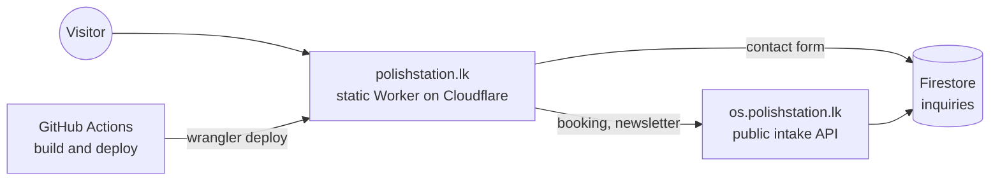

# Architecture

<!-- nav -->

<a href="../README.md">Project README</a> · <a href="README.md">Documentation index</a>

> How polishstation.lk is built and served. Part of the [project documentation](README.md).

## Overview

The website holds no customer data of its own. Every submission is handed to the [Polish Station OS](https://github.com/saadmaz/Polish-Station-OS), where staff manage bookings, leads and subscribers.

## Building blocks

| Part             | Responsibility                                                 |
| ---------------- | -------------------------------------------------------------- |
| `src/routes/`    | File-based routes, every one prerendered to HTML               |
| `src/lib/data/`  | Services, pricing, FAQ, gallery and reviews                    |
| `src/lib/api/`   | OS intake API client and Firestore enquiries                   |
| `src/lib/seo.ts` | Page metadata and structured data                              |
| `scripts/`       | Sitemap generation and Google reviews fetch, run at build time |

Significant decisions are recorded in [adr/](adr/README.md).
